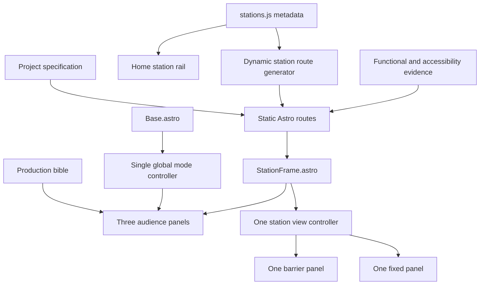

# A11y Test Kitchen Architecture

Status: Implemented for the full twelve-station collection; manual release matrix pending
Last updated: 2026-11-12
Authority: Technical boundaries, component ownership, state contracts, and implementation shape

## Purpose

This document describes the implemented architecture for twelve safe, consistent stations without a
client framework, backend, second source tree, or inaccessible abstraction. DEC-009 and DEC-010 resolve
the Station 07 and 08 safety conflicts through bounded, non-literal teaching patterns.

## Architectural principles

1. **Static by construction.** Every route is prerendered. There is no adapter, on-demand route, API endpoint, form backend, or runtime data dependency.
2. **Native HTML first.** Use semantic HTML controls and relationships before ARIA. Add ARIA only when it communicates real state the browser cannot infer.
3. **One behavior owner.** Global mode behavior initializes once in `Base.astro`; view behavior initializes once per station; station-specific behavior stays on its route.
4. **One data owner.** `src/data/stations.js` owns station metadata used by the rail and route-level headers.
5. **One DOM instance.** Barrier and fixed panels are never copied to create compare mode.
6. **Bounded failure.** Intentional failures cannot reach the masthead, mode control, skip link, reset/escape path, browser navigation, or another panel.
7. **Evidence before abstraction.** Station 01 established the component contract by hand; once Stations 02–12 proved the seven-section frame, Station 01 was folded onto it too. All twelve now share only that frame while keeping lesson behavior local.
8. **Source, not preview.** `src/` is canonical. Any preview is generated from the static build.

## System shape



## Target filesystem

```text
.
├── .nvmrc
├── astro.config.mjs
├── package.json
├── package-lock.json
├── README.md
├── roadmap.md
├── docs/
│   ├── ACCESSIBILITY-TEST-PLAN.md
│   ├── ARCHITECTURE.md
│   ├── DECISIONS.md
│   ├── PRODUCTION-BIBLE.md
│   ├── REQUIREMENTS-TRACEABILITY.md
│   └── STATION-AUTHORING.md
├── specs/
│   └── PROJECT.md
├── src/
│   ├── components/
│   │   ├── ChangedPanels.astro
│   │   ├── StateChip.astro
│   │   ├── StationFrame.astro
│   │   ├── StationPanel.astro
│   │   ├── StationTicket.astro
│   │   ├── ViewSwitch.astro
│   │   └── stations/
│   │       └── Station01.astro through Station12.astro
│   ├── assets/
│   │   ├── station-11-captions.vtt
│   │   ├── station-11-instructions.mp4
│   │   └── station-11-poster.png
│   ├── data/
│   │   └── stations.js
│   ├── layouts/
│   │   └── Base.astro
│   ├── pages/
│   │   ├── about.astro
│   │   ├── index.astro
│   │   ├── teachers.astro
│   │   ├── licenses/
│   │   │   └── ...static notice resources
│   │   └── stations/
│   │       └── [slug].astro
│   └── styles/
│       └── global.css
└── tests/
    ├── accessibility/
    ├── browser/
    └── fixtures/
```

The rail can show an unbuilt slot without a destination. `[slug].astro` prerenders built records
only and passes the canonical record to its station component. All twelve current records are
built. The home, About, and teacher guide bring the collection to fifteen HTML routes.

## Runtime and build contract

Accepted DEC-005 establishes this runtime and build contract:

- one accepted Astro major pinned in `package.json` and lockfile;
- Node 22 recorded in `.nvmrc` and the package engine field;
- `output: 'static'` explicitly documented in `astro.config.mjs`;
- no adapter and no route with `prerender = false`;
- no integration for React, Vue, Svelte, MDX, a CMS, or server output;
- production verification runs against `dist/`, not only the development server.

The verifier checks expected routes in the built artifact. Deploy or preview the contents of
`dist/` at an HTTP(S) origin root for root-relative navigation and assets. The static license
resources accompany the fonts and authored content in the same artifact.

## Component ownership

| Surface | Owns | Must not own |
|---|---|---|
| `Base.astro` | Document shell, skip link, masthead, mode buttons, main target, footer, global mode initialization, and in-body script slot | Station state or barrier behavior |
| `StationTicket.astro` | One rail item, built/unbuilt state, station metadata presentation | Station availability logic outside its props |
| `StateChip.astro` | Barrier/Fixed word + shape + tokenized color | Arbitrary statuses or its own script |
| `ViewSwitch.astro` | Native radio display modes and panel visibility contract from DEC-006 | Copies of either panel or station-specific form logic |
| `ChangedPanels.astro` | Advocate/Builder/Presenter slots and active-mode visibility | Persistence or duplicated global mode listeners |
| `StationFrame.astro` | Seven-section composition, role content, applicability labels, script forwarding, static fallback, and view wiring | Lesson-specific state or barrier behavior |
| `StationPanel.astro` | Stable panel root, state chip, hidden disclosure, and reset slot | A station state machine |
| Station component/route | Barrier/fixed markup, local state machine, resets, and lesson-specific content | Global navigation or another station's behavior |
| `stations.js` | Station metadata and rail status | Long-form station copy or executable behavior |
| `global.css` | All tokens and all authored styles | Data, copy, or behavioral state transitions |

## Station metadata contract

`src/data/stations.js` exports an ordered array with this implemented record shape:

```js
{
  id: "01",
  slug: "cancellation-form",
  title: "The cancellation form",
  category: "Time limits and error recovery",
  task: "Cancel a membership",
  barrierPattern: "Session timer, placeholder labels, destructive errors",
  status: "built",
  criteria: [
    {
      id: "2.2.1",
      title: "Timing Adjustable",
      level: "A",
      source: "https://www.w3.org/TR/WCAG22/#timing-adjustable",
      titleVerifiedOn: "2026-11-12",
      applicability: "confirmed"
    }
  ]
}
```

Contract rules:

- `id` is a zero-padded string and unique.
- `slug` is stable, unique, lowercase kebab-case, and is the route segment.
- `status` is one of `not-built` or `built`; do not add “in progress” to the public rail.
- `built` is the availability state for a complete route and links the rail to it as “Ready to try.”
  Track WCAG evidence and release verification in the release evidence index.
- Manual support-matrix and publication readiness remain separate evidence states; every station brief
  stays `AUDITING` until its named checks are recorded.
- Criterion title verification and applicability review are separate fields.
- The route imports metadata; it does not duplicate title, number, task, or criteria.
- Long-form explanation copy is passed from each station component to the shared frame; it remains lesson-owned and is not stored in the rail metadata.

## Global audience mode contract

The header renders three native `button` elements in a labelled group:

- Advocate
- Builder
- Presenter

When the script initializes the mode control, exactly one button has `aria-pressed="true"`. The
rest have `aria-pressed="false"`. Every mode panel has a stable mode marker such as
`data-atk-mode-panel="builder"`.

### Initialization

1. Server-render the Advocate summary as the readable lesson. Interactive controls start hidden
   and are exposed after their controllers initialize.
2. In one inline script owned by `Base.astro`, read `localStorage.getItem("atk-mode")` inside `try/catch` and set a validated mode on the document root as early as practical.
3. Accept only `advocate`, `builder`, or `presenter`; otherwise use `builder`.
4. Bind controls and panel visibility after the relevant DOM exists—either place the script after the layout slot or use one `DOMContentLoaded` initializer.
5. Update all mode buttons and panels from the root mode.
6. On selection, update the page immediately and attempt to persist inside `try/catch`.
7. Storage failure never prevents mode switching during the current page session.

Inactive mode content uses the native `hidden` attribute so it is absent from layout, focus order, and the accessibility tree. Do not rely on off-screen CSS alone.

### Script placement constraint

Astro renders an `is:inline` script each time the component containing it is rendered. Therefore:

- the global mode script appears only in `Base.astro`;
- `ChangedPanels.astro` contains no initialization script;
- station scripts pass through the frame into the layout's script slot inside the document body;
- the initializer is idempotent and marks the document root after binding listeners;
- tests fail if a mode button produces duplicate event handling.

## Station view contract

Accepted DEC-006 uses three native radio buttons inside a labelled `fieldset`. Checked state communicates the single active display mode; `aria-controls` identifies the affected existing panel or panels. Do not add tab roles or `aria-selected`.

| Mode | Barrier panel | Fixed panel | Layout |
|---|---|---|---|
| Barrier | Shown | Hidden | One column |
| Fixed | Hidden | Shown | One column |
| Compare | Shown | Shown | Two columns at 60rem+, stacked below |

Implementation rules:

- Both panel elements exist once in the DOM.
- The controller changes `hidden` and a root view-state data attribute; it does not replace panel markup.
- Changing views does not reset either panel.
- A hidden panel contains no active focus and no running timer unless its station brief explicitly requires continued state and the safety review approves it.
- If the current focus would become hidden, move focus to the newly selected view control or the revealed panel heading according to the accepted interaction spec.
- Comparison order is Barrier then Fixed in both DOM and narrow-screen visual flow.
- The controller is initialized once because each station has exactly one view switch.

## Station interaction contract

Each station route owns a small state machine. State is in memory only and is never stored across routes.
The interactive area stays hidden until both the station and view controls have bound their events.
The task and Advocate explanation provide a static reading path while scripts are unavailable.

### Required state categories

- documented starting state;
- visitor-entered values;
- attempt count where the lesson requires it;
- current step where the fix is multi-step;
- validation/status messages;
- timer handles and remaining time where the barrier requires timing;
- completion state.

### Reset contract

Each panel reset:

1. cancels its timers and pending callbacks;
2. clears transient messages, attempts, and completion state;
3. restores the documented initial values and step, including closed disclosures and cleared
   review-only copies of entered values;
4. returns focus to the panel's stable start heading or first task control;
5. changes no state in the other panel, mode control, or view control.

Do not implement reset as an indiscriminate page reload; that would also erase the comparison context and can hide cleanup defects.

## Barrier quarantine

A barrier panel is not an accessibility sandbox. It remains part of the full page and must preserve non-interference.

Required boundaries:

- a visually hidden “This version is broken on purpose.” note is associated with the panel;
- the panel root has a stable station-specific identifier;
- only the approved named failure may be present;
- a reset and escape route are controlled by safe host code that the barrier cannot disable;
- no global event interception;
- no focus loop without a standard keyboard exit;
- no blocking of Escape, browser Back, page scroll, or the skip link;
- timers are cancelled when reset or when their lifetime ends;
- expected automated findings are registered in the test ledger before code is approved.

No iframe is planned. An iframe would not make a blanket full-page conformance claim valid and could create additional focus/navigation complexity.

## CSS and design-system contract

All authored styles live in `src/styles/global.css`.

Suggested organization inside that one file:

1. Font import
2. Root tokens
3. Reset and base elements
4. Landmarks and page layout
5. Global controls and focus
6. State grammar
7. Rail and tickets
8. Station shell and view layouts
9. Form and feedback patterns
10. Utility classes, including visually hidden
11. Station-specific selectors, namespaced by station slug
12. Responsive queries
13. Forced-colors adjustments
14. Reduced-motion override last

Rules:

- Hex values appear only in `:root` token declarations.
- Components consume semantic tokens, not raw palette values.
- Barrier and Fixed always carry word and shape in markup; pseudo-elements do not provide the only non-color signal.
- Focus appearance is intentionally authored and tested at 3:1 against adjacent colors.
- Layout uses fluid sizing and intrinsic wrapping. Avoid fixed widths on text/form controls that cause zoom overflow.
- The final reduced-motion block sets animation and transition duration to effectively none for all authored effects.

## IDs and selectors

IDs use stable prefixes:

```text
atk-[station-number]-[panel]-[purpose]
```

Examples:

- `atk-01-barrier-member-number`
- `atk-01-fixed-step-2-heading`
- `atk-01-fixed-error-summary`

Rules:

- Never derive IDs from localized or display copy.
- Barrier and fixed IDs always include the panel segment.
- Labels, descriptions, alerts, and controls are connected through explicit IDs.
- JavaScript scopes queries to the nearest station or panel root rather than global IDs where practical.
- Test selectors use `data-testid` only when a semantic role/name or stable station marker cannot identify the behavior.

## Content and HTML contract

- One `h1` names the page task.
- Section headings follow a meaningful hierarchy; visual size does not determine heading level.
- Native form controls and visible labels are the default.
- Placeholder text never substitutes for a label in fixed panels.
- Error text identifies the field, describes the issue, and suggests a correction when known.
- Status messages use the appropriate live-region or alert behavior without unnecessary focus movement.
- Active, empty error regions remain exposed to assistive technology before their content changes.
- Authored field boundaries and focus indicators meet 3:1 contrast where needed to identify the
  control or its state.
- Code snippets in Builder panels are escaped and presented as text, never executed.
- External links identify their destination in meaningful link text.

## Privacy and network contract

- Forms use fictional data and keep answers in the page. Demo forms use `method="dialog"` outside
  a dialog to prevent native submission, and the document sets `form-action 'none'` as a second
  guard. The browser receives no invitation to autofill a real name, postal code, or one-time code.
- Page loads and demonstration interactions must make zero automatic third-party requests.
  Static verification covers declarations in emitted HTML and CSS. Browser tests observe actual
  requests during the page loads and interactions they exercise. Outbound WCAG reference links
  navigate away when a visitor chooses them.
- No analytics, tracking pixels, cookies, or telemetry.
- Outfit, Space Mono, and Station 11 media are local assets. System fallback fonts preserve
  readability if a font asset fails to load.
- No localStorage key other than `atk-mode` without an accepted requirement.
- Hosting logs are controlled by the site operator. The exhibit implements no tracking of its own.
- No public AI call, API key, or generated-on-request content.

## Verification boundaries

The architecture is not accepted because the build passes. Evidence must cover:

- static route generation;
- component/state contracts;
- no native form submission when scripts are unavailable, and a readable lesson fallback;
- declared resource and runtime network boundaries;
- duplicate IDs in every exposed view;
- keyboard behavior and escape paths;
- mode storage failure;
- 200% zoom and responsive compare layout;
- reduced motion and forced colors;
- exact intentional-failure results;
- real assistive-technology smoke tests for each new interaction pattern.

See [test procedures](ACCESSIBILITY-TEST-PLAN.md), [requirements traceability](REQUIREMENTS-TRACEABILITY.md),
and the [current release evidence](evidence/README.md).

## Normative and implementation references

- [Web Content Accessibility Guidelines (WCAG) 2.2](https://www.w3.org/TR/WCAG22/)
- [WAI-ARIA Authoring Practices: Tabs Pattern](https://www.w3.org/WAI/ARIA/apg/patterns/tabs/)
- [WAI-ARIA Authoring Practices: Button Pattern](https://www.w3.org/WAI/ARIA/apg/patterns/button/)
- [Astro documentation: Scripts and event handling](https://docs.astro.build/en/guides/client-side-scripts/)
- [Astro documentation: Upgrade Astro](https://docs.astro.build/en/upgrade-astro/)
- [Astro documentation: Upgrade to Astro 7](https://docs.astro.build/en/guides/upgrade-to/v7/)

These sources inform the architecture but do not substitute for testing in the accepted support matrix.

## Architecture approval gate

- [x] DEC-003 canonical source policy accepted
- [x] DEC-004 greenfield baseline accepted
- [x] DEC-005 framework/runtime baseline accepted
- [x] DEC-006 view-control semantics accepted and reflected here
- [x] DEC-007 conformance language accepted
- [x] DEC-008 intentional-failure policy accepted
- [x] DEC-011 support matrix accepted
- [x] DEC-015 automation stack accepted
- [x] DEC-009 and DEC-010 safe teaching patterns accepted and implemented
- [x] DEC-016 local Station 11 media and provenance accepted and implemented
- [x] Component and state ownership has no overlap across the collection
- [x] All twelve stations implement the shared contract without a second source tree or duplicated panels
